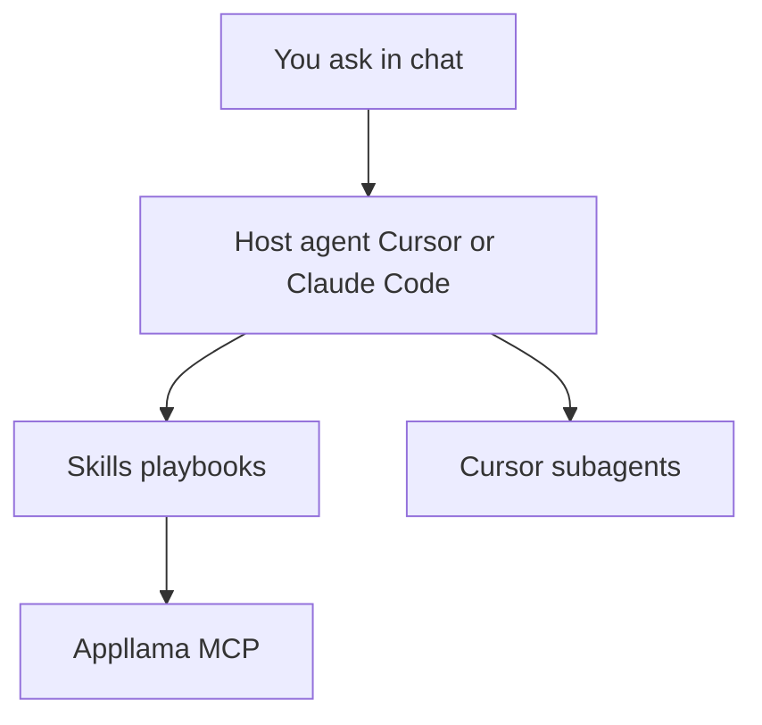

# How to use the different agents

This repo has Appllama skills installed for Cursor (and agents), plus Cursor’s
own subagent system. Treat them as three layers that stack.

---

## 1. Appllama skills (what to study vs how to build)

Two skills, meant to be used **together**:

| Skill | Job | When it kicks in |
|---|---|---|
| [`appllama-usage`](.cursor/skills/appllama-usage/SKILL.md) | Research engine for the Appllama MCP | Mobile app research, onboarding/paywall study, “study top apps first” |
| [`appllama-app-design-skill`](.cursor/skills/appllama-app-design-skill/SKILL.md) | Build bar for native Expo / React Native UI | Designing/implementing screens, motion, navigation, polish |

**How to use them in practice**

1. Connect Appllama MCP: `https://mcp.appllama.io/mcp` (Pro account; configured in [`.cursor/mcp.json`](.cursor/mcp.json)).
2. In Cursor: **Settings → Tools & MCP → Appllama → Connect**, then approve with your Appllama account.
3. Ask in natural language — you don’t invoke skill names manually. Good prompts:
   - “Build me a habit tracker. Study top-grossing habit apps first.”
   - “Make this screen better” + screenshot or Appllama Screen ID (`app_id/screen_id`).
   - “How do the best fitness apps structure onboarding and where does the paywall sit?”
4. Expected loop: **usage** researches (`get_credits` → `search_apps` → walk screens) → **app-design** implements to HIG / anti-slop / simulator bar.
5. `appllama-app-design-skill` still helps without MCP; `appllama-usage` needs MCP connected.

Also installed: [`supabase-server`](.agents/skills/supabase-server/SKILL.md) — loads when writing `@supabase/server` backend/auth code. Unrelated to Appllama; different domain.

---

## 2. Agent platforms (Cursor vs Claude Code)

Same skills, different install paths. The `-a` flag in `npx skills` chooses **which agent’s skills folder** gets the files.

| Platform | Typical install path | What you do |
|---|---|---|
| **Cursor** | `.cursor/skills/` (project) or user skills | Already installed here; connect MCP in Settings → Tools & MCP → Appllama |
| **Claude Code** | `.claude/skills/` or `~/.claude/skills/` | Install with `-a claude-code`, connect the same MCP URL as a custom connector |
| **Both** | `npx skills@latest add appllama/appllama-skills -a claude-code -a cursor -y` | One command, no prompts |
| **User-wide** | `-g` | Skills available in every project for that agent |

**Usage difference:** once installed + MCP connected, prompts are the same. Cursor loads skills from `.cursor/skills/`; Claude Code from its skills folder. You talk to whichever host agent you’re in — you don’t switch “Appllama agents” inside the chat.

---

## 3. Cursor subagents (specialists the main agent can spawn)

These are **Cursor-internal workers**, not Appllama. The main chat agent delegates via Task when a job fits. You usually just ask; naming the type helps.

| Subagent | Use for |
|---|---|
| **explore** | Fast codebase search / “where does X live?” |
| **generalPurpose** | Multi-step research or coding that doesn’t fit a specialist |
| **computerUse** | Manual browser / GUI testing of a running app |
| **videoReview** | Analyzing recorded demos / screen recordings |
| **cursor-guide** | “In Cursor, how do I…?” product questions |
| **ci-investigator** | Dig into one failing PR CI check |
| **bugbot** / **security-review** | Explicit review of local changes (only when you ask) |
| **best-of-n-runner** | Isolated parallel attempts on separate branches |
| **performance-marketing-agent** | Ads / campaigns (Adspirer) |
| Domain specialists (ai-architect, deployment-expert, etc.) | Vercel / architecture / perf when that stack applies |

**Cloud Agents** (separate from subagents): long-running VMs on a branch. Use for bigger repo work, PRs, background jobs. Local Agent chat is for interactive iteration; Cloud Agent is for autonomous branch work.

**How to steer them**

- Normal: “Find where routing is configured” → explore.
- Explicit: “Use computerUse to click through the FAQ page.”
- Parallel: “Explore auth and billing in parallel.”
- Don’t over-delegate: single-file or one-tool answers stay in the main agent.

---

## Quick start checklist

1. Confirm Appllama is connected in Cursor MCP settings.
2. For mobile UI work, ask with “study top apps first” so usage + design both load.
3. For Supabase server auth, just start writing/planning that code — `supabase-server` skill triggers.
4. For repo spelunking / UI click-testing / CI failure digs, ask plainly or name the Cursor subagent.
5. Use Cloud Agents when you want autonomous branch + PR work; use interactive chat for guided how-tos and local iteration.

## Demo artifacts in this repo

- [`research/habit-onboarding/`](research/habit-onboarding/) — worked example of the Appllama **usage** research playbook (habit-app onboarding).
- Mobile tab screens under `packages/mobile/app/(tabs)/` — polished with **appllama-app-design-skill** anti-slop / hierarchy rules.
